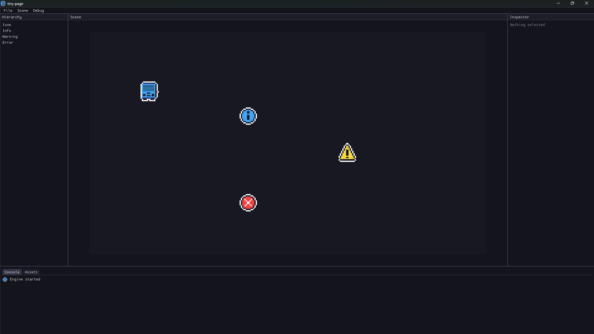
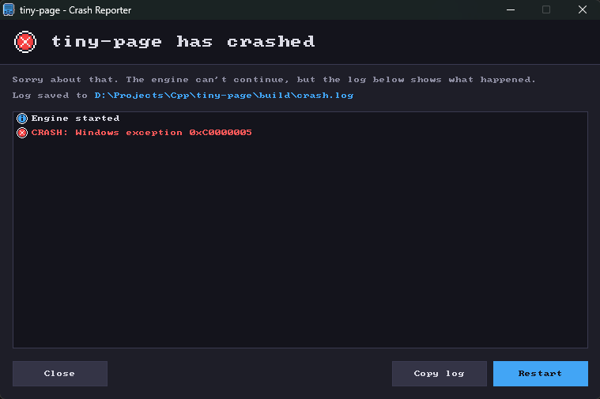

<div align="center">


# tiny-page

**A tiny, pixel-perfect 2D game engine and editor written in C++20.**


<br />



</div>

<br />

## ✨ Overview

tiny-page is a small engine with a Godot/Unity-style editor and a crisp pixel-art look.
It is built to stay **simple and readable**: two libraries, a handful of small headers, and one
shared look for every window.

## 🎮 Features

| | |
|---|---|
| 🖥️ **Editor** | Menu bar, **Hierarchy**, **Scene** view, **Inspector** and a bottom panel with **Console** and **Assets** tabs |
| 🔲 **Pixel-perfect scene view** | The scene is drawn into a 320×180 render target and scaled up in whole-number steps with nearest-neighbor filtering, so pixels stay sharp at any window size |
| 📜 **Live console** | Every `SDL_LogInfo / SDL_LogWarn / SDL_LogError` call shows up in the Console tab with its own icon and color |
| 💥 **Crash Reporter** | An Unreal-style window that catches uncaught exceptions, `abort()` and hard crashes, hides the other windows, shows the full log, saves `crash.log`, and offers **Copy log** and **Restart** |
| 🪟 **Multi-window ready** | Many OS windows in one process, each with its own renderer, all registered in one place |
| 📦 **One executable** | SDL3 is linked statically and the assets are copied next to the `.exe` |
| 🎨 **One look** | A single palette in `UI.hpp` drives every window |

<div align="center">

</div>

## 🚀 Getting started

### Requirements

- Windows 10/11
- [CMake](https://cmake.org/) 3.24 or newer
- A MinGW-w64 `g++` with C++20 support
- [Git](https://git-scm.com/) (CMake uses it to download SDL3 and Dear ImGui)

### Build and run

```powershell
git clone https://github.com/Spolii/tiny-page.git
cd tiny-page

cmake -S . -B build -G "MinGW Makefiles"
cmake --build build
.\build\tiny-page.exe
```

The first configure downloads SDL3 and Dear ImGui, so it takes a little longer.

## 🧰 Try it

| Action | How |
|---|---|
| Select an object | Click it in **Hierarchy** |
| Move or rename it | Edit **Name** and **Position** in **Inspector** |
| Add an object | **Scene → Add Object** |
| Print to the console | **Debug → Log info / warning / error** |
| See the crash reporter | **Debug → Crash: exception** or **Crash: null pointer** |

## 🗂️ Project structure

```
tiny-page/
├─ CMakeLists.txt
├─ docs/                  screenshots
└─ src/
   ├─ main.cpp            entry point and main loop
   ├─ assets/             icons used by the editor and console
   ├─ core/
   │  ├─ Window.hpp       one OS window + renderer
   │  ├─ Log.hpp          captures SDL log output
   │  ├─ LogView.hpp      draws the log with icons
   │  ├─ UI.hpp           shared palette, buttons, text helpers
   │  ├─ Crash.hpp        crash handlers and the Crash Reporter
   │  └─ Assets.hpp       asset paths and texture loading
   └─ engine/
      ├─ Scene.hpp        entities and the scene
      └─ Editor.hpp       the editor panels
```

## 🗺️ Roadmap

- [x] Multi-window base
- [x] Logger and console
- [x] Crash Reporter
- [x] Editor layout: Hierarchy, Scene, Inspector, Console
- [ ] Save and load scenes
- [ ] Play mode
- [ ] Asset browser
- [ ] Dockable panels

## 🙏 Built with

- [SDL3](https://libsdl.org/) for windows, rendering and input
- [Dear ImGui](https://github.com/ocornut/imgui) for the editor panels

## 📄 License

Released under the [MIT License](LICENSE).